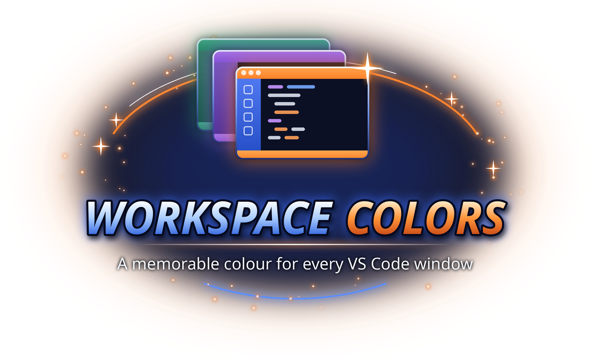

# Workspace Colour Wheel

Give each VS Code workspace its own colour so you can tell project windows apart at a glance.

## Features

- Automatically assign a colour when you open a workspace.
- Pick a custom colour with a wheel and RGB and HSV controls.
- Choose a named palette or cycle through the available colours.
- Adjust the intensity and preview the available colour schemes.
- Save your choice for the workspace and reuse it when you return.

## Get started

1. Install **Workspace Colour Wheel** from the [Visual Studio Marketplace](https://marketplace.visualstudio.com/items?itemName=RichardBeech.workspace-colour-wheel). VS Code 1.85 or newer is required.
2. Open a folder or workspace. A colour is assigned automatically by default.
3. Click the colour name in the status bar, or open the Command Palette (`Ctrl+Shift+P` on Windows/Linux, `Cmd+Shift+P` on macOS) and run **Workspace Colors: Open Colour Wheel**.
4. Choose a colour on the wheel, adjust the controls and select a scheme. Click **Apply colour and scheme** to save it. Click **Close** when finished.

The picker also offers a random colour in the selected scheme. Your choice is remembered for the same workspace on the same VS Code installation/profile.

## Commands

Open the Command Palette and search for **Workspace Colors**:

| Command | What it does |
| --- | --- |
| Open Colour Wheel | Choose a custom colour and scheme. |
| Choose Named Palette | Select one of eight named palettes. |
| Cycle Colour | Move to the next named palette. |
| Choose Intensity | Select Bright, Shaded, Umbra, Subdued or Dim. |
| Clear Colour | Remove the colours managed by the extension from the current workspace. |

## Settings

Find these in VS Code Settings by searching for `workspaceColors`:

| Setting | Default | What it does |
| --- | --- | --- |
| `workspaceColors.autoAssign` | `true` | Assign a colour automatically when a workspace opens. |
| `workspaceColors.showStatusLabel` | `true` | Show the colour name in the status bar. |
| `workspaceColors.intensity` | `Subdued` | Set the default intensity; individual workspaces can override it. |

## Colour settings and troubleshooting

- The extension writes its colours to `workbench.colorCustomizations`. Back up existing colour settings first: it overwrites the keys it manages, and **Clear Colour** removes those keys rather than restoring their former values. Other keys are retained.
- Open a folder or workspace for project-specific colours. An empty window uses global settings, which can affect other windows that inherit them.
- Automatic assignment tries to choose an unused named palette, but colours can repeat when the available palettes are in use.
- If you change your VS Code theme while the wheel is open, close and reopen the wheel to refresh its previews.
- If the title bar does not change colour, your system may use a native title bar. Set `window.titleBarStyle` to `custom` to use VS Code's custom title bar.

## Privacy

The extension runs locally and sends no telemetry.

## Licence

Copyright © 2026 Richard Beech / 1larity. User-owned code, documentation and assets
are licensed under [Creative Commons Attribution-NonCommercial-ShareAlike 4.0
International](https://creativecommons.org/licenses/by-nc-sa/4.0/)
(**CC BY-NC-SA 4.0**). Credit the author and source, link the licence, indicate
changes, use non-commercially and share adaptations under the same licence.
Third-party material retains its own terms; previous licence grants are not revoked.
See [LICENSE](LICENSE) for the legal text.
