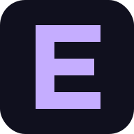

<p align="center"></p>

# Workspace Colors

Give each VS Code workspace a memorable title bar, sidebar, and status bar colour.

## Install

Requires VS Code 1.85.0 or newer. Download **vscode-workspace-colors-0.9.4.vsix** from the
[EVILE project page](https://evile.uk/redesign/projects/workspace-colors/).

1. Open **Extensions → … → Install from VSIX…**.
2. Select the downloaded file.
3. Run **Developer: Reload Window** if the extension has not appeared.

Or install from a terminal:

```sh
code --install-extension vscode-workspace-colors-0.9.4.vsix
```

Give VS Code projects their own colours. Includes a colour wheel, RGB/HSV sliders,
five intensity schemes (Bright, Shaded, Umbra, Subdued, Dim), dark/light palettes,
and previews for title bar, editor background and pane header.

## Choose a colour

Download the VSIX from https://evile.uk/redesign/projects/workspace-colors/ and run:

```sh
code --install-extension vscode-workspace-colors-0.9.4.vsix
```

Or use Extensions → … → Install from VSIX. Run Developer: Reload Window afterwards.
Click the colour status item or run Workspace Colors: Open Colour Wheel.
Apply saves without closing; Close dismisses the picker. Named palettes and
intensity also have separate commands. Saved workspace choices are reused when
reopening the same workspace on the same VS Code installation/profile.

## Preview limitations and settings

- Automatically writes workbench.colorCustomizations on activation. Back up existing
  colour settings first: managed keys are overwritten, and Clear removes those keys
  rather than restoring previous values. Unrelated keys are retained.
- Empty windows use global settings, affecting other windows which inherit them.
  Open a folder/workspace for independent project settings.
- Eight named colours: random assignments are best effort, not guaranteed distinct
  across simultaneously opened windows. Historical assignments are retained.
- After changing theme with the picker open, close and reopen it to refresh previews.
- Custom title-bar colours require window.titleBarStyle set to custom on systems
  using a native title bar. This extension does not change that setting.
- UI/theme coverage is still being validated; this is a preview, not a 1.0 release.
- No accounts, credentials, telemetry or runtime network calls are required.

## Privacy and workspace trust

No telemetry is sent by this extension. Review provider-specific credential
handling above. Never include keys, tokens or account responses in bug reports.

## Licence

Copyright © 2026 Richard Beech / 1larity. User-owned code, documentation and assets
are licensed under [Creative Commons Attribution-NonCommercial-ShareAlike 4.0
International](https://creativecommons.org/licenses/by-nc-sa/4.0/)
(**CC BY-NC-SA 4.0**). Credit the author and source, link the licence, indicate
changes, use non-commercially and share adaptations under the same licence.
Third-party material retains its own terms; previous licence grants are not revoked.
See [LICENSE](LICENSE) for the legal text.

## Developer guide

The extension is plain CommonJS JavaScript with **no runtime npm dependencies**
and no compilation step. Use Node.js 22+ for development.

```sh
npm test
node --check extension.js
npx --yes @vscode/vsce@4.0.0 package --no-dependencies
```

Open the checkout in VS Code and press **F5** to launch an Extension Development
Host. Tests run locally with synthetic fixtures; they do not prove live provider
availability or interactive UI acceptance.

- `extension.js`: VS Code integration.
- `lib/` (quota monitors): provider clients, parsers and monitor lifecycle.
- `test/`: offline regression coverage.
- `.vscodeignore`: package allow-list; excludes tests, screenshots, credentials,
  local editor settings, source artwork and previous VSIX files.

Gitea is the canonical development home. GitHub's `public` branch is a curated
standalone snapshot; it intentionally does not contain private development
history, experimental branches or tags. Each checkout can run its tests without
access to the canonical workspace. Shared quota modules are vendored locally;
changes must also be synchronized in the canonical quota workspace before a release.

See [SECURITY.md](SECURITY.md) for sensitive reporting guidance.
